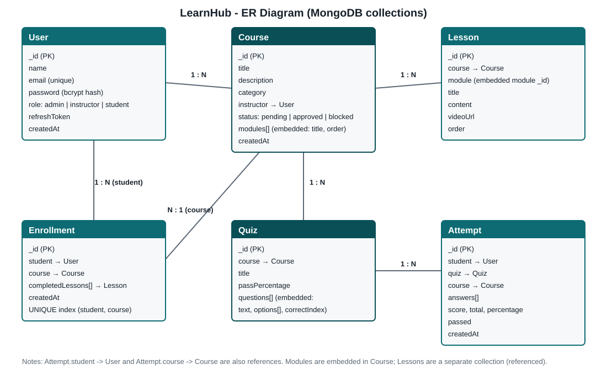

# LearnHub – Learning Management System (MERN)
 
Instructors publish courses (modules → lessons + quizzes), students enrol, track lesson progress and take auto-graded quizzes, and admins approve or block courses.
 
**Stack:** Express, Mongoose, dotenv, bcrypt, jsonwebtoken (+ cors) · React (Vite), react-router-dom, Fetch API, Context API.
 
## Demo and links
 
- Demo video: <video ka link>
- GitHub repository: https://github.com/ks4465831-cloud/Learnhub-Capstone-Project
- Deployed frontend: https://learnhub-capstone-project.vercel.app/
- Deployed backend (API): https://learnhub-capstone-project.onrender.com/  (health check: /api/health)

- Postman collection: `backend/LearnHub.postman_collection.json` (set the `baseUrl` variable to `http://localhost:5001/api`)
- ER diagram: `docs/ER_diagram.svg`

## Run locally
 
Requirements: Node 18+ and MongoDB (local or Atlas).
 
```bash
# 1. Backend
cd backend
cp .env.example .env        # Windows CMD: copy .env.example .env
npm install
npm run seed                # creates the first admin (see ADMIN_* in .env)
npm run dev                 # http://localhost:5001
 
# 2. Frontend (new terminal)
cd frontend
npm install
npm run dev                 # http://localhost:5174  (proxies /api to :5001)
```
 
Default admin after `npm run seed`: `admin@learnhub.com` / `Admin@123` (change in `.env`).
 
## Environment variables (backend/.env)
 
| Name | Meaning |
|---|---|
| PORT | API port (5001) |
| MONGO_URI | MongoDB connection string |
| JWT_ACCESS_SECRET / JWT_REFRESH_SECRET | Secrets for the two tokens |
| ACCESS_EXPIRES / REFRESH_EXPIRES | Token lifetimes (15m / 7d) |
| CLIENT_URL | Allowed CORS origin (frontend URL, e.g. http://localhost:5174) |
| ADMIN_NAME / ADMIN_EMAIL / ADMIN_PASSWORD | Used by `npm run seed` |
 
Frontend: `VITE_API_URL` (only needed in production, e.g. your deployed backend URL).
 
## Folder structure (MVC)
 
```
backend/
  config/       db connection
  models/       User, Course, Lesson, Enrollment, Quiz, Attempt
  controllers/  auth, course, lesson, enrollment, quiz, analytics, admin
  routes/       one router per resource
  middleware/   auth (protect, optionalAuth, authorize), error handling
  utils/        AppError, asyncHandler, tokens, access helpers
  server.js, seed.js
frontend/src/
  api.js (fetch wrapper + auto refresh), context/AuthContext.jsx,
  components/ (Navbar, ProtectedRoute), pages/
docs/
  ER_diagram.svg
```
 
## Project requirements checklist
 
- **MVC + .env:** see structure above; `.env` is in `.gitignore`.
- **Auth:** bcrypt hashing (User pre-save hook); JWT access token (15m) + refresh token (7d, rotated on every refresh, stored on the user, cleared on logout).
- **Protected + RBAC routes:** `protect` for any logged-in user; `authorize('instructor')`, `authorize('student')`, `authorize('admin')` for role routes. Admin accounts cannot be self-registered (use seed).
- **Mongoose validation + relationships:** Course → instructor (User); Lesson → Course; Enrollment → User + Course; Quiz → Course; Attempt → User + Quiz + Course.
- **Embedded vs referenced:** modules are *embedded* in Course; lessons are *referenced* (own collection); quiz questions are embedded in Quiz.
- **Indexes:** unique compound `{student, course}` on Enrollment (no double enrolment); text index on Course title/description (search); `{status, category}`, `{course, order}` and more.
- **Aggregation:** instructor analytics (enrolments per course, average score, pass rate), admin stats (users by role, courses by status, top courses with `$lookup`), lesson totals for progress.
- **Error handling:** centralised `middleware/error.js` – 400 validation/cast, 401 auth, 403 role, 404, 409 duplicate, 500.
- **Quiz security:** correct answers are never sent to students; grading happens on the server and every attempt is stored.
- **Frontend:** React with routing, controlled forms, Context API and protected pages.
## Workflow to demo
 
1. Register an **instructor** → create a course → add modules, lessons and a quiz (course is `pending`).
2. Log in as **admin** (seeded) → Admin panel → approve the course.
3. Register a **student** → browse/search → enrol → tick lessons, take the quiz.
4. Instructor dashboard now shows enrolments, attempts, average score and pass rate.
## API summary (all prefixed with /api)
 
| Method | Path | Access |
|---|---|---|
| POST | /auth/register, /auth/login, /auth/refresh | public |
| POST | /auth/logout · GET /auth/me | logged in |
| GET | /courses (q, category, page, limit) | public |
| GET | /courses/:id | public (owner/admin see non-approved) |
| POST | /courses · GET /courses/mine/list | instructor |
| PUT/DELETE | /courses/:id | owner instructor / admin |
| POST | /courses/:id/modules, /courses/:id/lessons, /courses/:id/quizzes | owner instructor |
| GET | /courses/:id/lessons, /courses/:id/quizzes | owner / admin / enrolled student |
| PUT/DELETE | /lessons/:lessonId | owner instructor / admin |
| DELETE | /quizzes/:id | owner instructor / admin |
| POST | /courses/:id/enroll | student |
| GET | /enrollments/me, /enrollments/:courseId | student |
| POST | /enrollments/:courseId/lessons/:lessonId/complete | student (toggle) |
| POST | /quizzes/:id/attempt · GET /quizzes/attempts/me | student |
| GET | /analytics/instructor | instructor |
| GET | /analytics/admin | admin |
| GET | /admin/courses, /admin/users · PATCH /admin/courses/:id/status | admin |
 
Import `backend/LearnHub.postman_collection.json` into Postman (login requests save the token automatically).
 
## ER diagram
 

 
```
User 1───* Course 1───* Lesson
 │           │ 1
 │           └──* Quiz 1───* Attempt *───1 User
 └──* Enrollment *───1 Course      (Enrollment.completedLessons → Lesson[])
```
 
## Deployment tips
 
- Backend (Render/Railway): set the env variables above, start command `npm start`, MongoDB Atlas for `MONGO_URI`, `CLIENT_URL` = frontend URL.
- Frontend (Vercel/Netlify): build `npm run build`, output `dist`, env `VITE_API_URL` = backend URL. Add a rewrite of all paths to `/index.html` so React Router works on refresh.
 